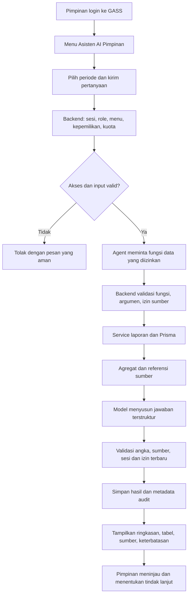

# Rencana Implementasi AI Agent Pimpinan GASS

Tanggal: 19 Oktober 2026  
Status: rencana implementasi; fitur AI belum diimplementasikan oleh dokumen ini.  
Sasaran awal: pengguna dengan peran `KEPALA_DINAS`.  
Nama menu usulan: **Asisten AI Pimpinan** (`ai_pimpinan`).

## 1. Tujuan dan keputusan utama

Menambahkan asisten AI di GASS agar pimpinan dapat bertanya dengan bahasa Indonesia tentang capaian kinerja, SPM/IKU, realisasi keuangan, dan perbandingan faskes. Jawaban harus bersumber dari data GASS yang dapat diakses pengguna, menyertakan periode dan sumber, serta menyediakan rekomendasi untuk ditinjau pimpinan.

Rekomendasi implementasi awal adalah **satu AI Agent di backend NestJS, menggunakan OpenAI Responses API melalui SDK TypeScript, dengan fungsi pembacaan data yang dibatasi**. PostgreSQL, Prisma, autentikasi, dan antarmuka Next.js yang sudah ada tetap digunakan. Model AI dipilih melalui evaluasi dan diatur lewat konfigurasi server.

AI Agent di sini berarti sistem yang memahami pertanyaan, memilih fungsi data yang tersedia, membaca hasilnya, kemudian menyusun jawaban. Satu agent dapat menangani analisis kinerja, keuangan, dan bahan rapat melalui beberapa fungsi; tidak memerlukan banyak agent terpisah pada tahap awal.

Keputusan desain:

- AI membantu analisis dan penyusunan draf; keputusan resmi tetap dilakukan pimpinan.
- Hak AI mengikuti otorisasi pengguna yang sedang masuk, bukan akun superadmin.
- Versi awal hanya membaca data operasional. Penyimpanan percakapan dan audit diperbolehkan melalui layanan khusus AI.
- Perhitungan angka dilakukan oleh kode backend; model menjelaskan hasil perhitungan.
- Data yang diberikan kepada penyedia AI berupa agregat minimum yang diperlukan, tanpa kredensial, data sesi, atau identitas pegawai yang tidak relevan.
- Implementasi awal tidak memerlukan vector database, pelatihan model, atau integrasi kanal pesan eksternal.

## 2. Kondisi proyek yang menjadi dasar

Temuan berikut berasal dari kode repository saat rencana dibuat.

| Komponen | Kondisi saat ini | Dampak terhadap rencana |
| --- | --- | --- |
| Backend | NestJS 11, TypeScript, Prisma 7, PostgreSQL | Modul AI dibangun di backend yang sama |
| Frontend | Next.js 16, React 19, Tailwind 4, shadcn, TanStack Query, Recharts | Gunakan komponen dan pola API yang tersedia |
| Login | eGov/Simpeg, access JWT, cookie HttpOnly, refresh token dan sesi lokal | Tidak perlu login AI terpisah |
| Peran | `ADMIN_DINKES`, `AKUN_BIDANG`, `OPERATOR_PUSKESMAS`, `KEPALA_DINAS` | Pimpinan dipetakan ke `KEPALA_DINAS`, bukan ditebak dari nama jabatan |
| Izin menu | `MENUS`, `hardPermission`, `defaultPermission`, dan tabel `MenuPermission` | Menu AI perlu ditambahkan pada backend dan frontend |
| Batas pimpinan | `assertWriter()` menolak mutasi oleh `KEPALA_DINAS` | Aturan ini tetap berlaku pada data operasional |
| Dashboard | Diimplementasikan dalam `ReportsService.dashboard()`, bukan modul dashboard terpisah | Gunakan ulang logika laporan dengan adapter AI |
| Verifikasi | `isValidated` berada di record laporan tahunan | Jangan mengklaim ada verifikasi bulanan |
| Nilai bulanan | Kolom Januari–Desember memiliki nilai awal `0` | Nol tidak membuktikan belum mengisi atau terlambat |
| Ranking | Dashboard mengecualikan sejumlah nama rumah sakit | Jelaskan populasi ranking; jangan menyebut semua faskes jika hanya mencakup puskesmas |
| Antrean | Redis dan BullMQ sudah digunakan pada layanan notifikasi | Dapat digunakan untuk laporan AI panjang pada fase lanjutan |
| Audit | Tabel `AuditLog` tersedia | Tambahkan metadata aktivitas AI dengan penyaringan data sensitif |

Referensi lokal:

- [Pedoman proyek](AGENTS.md)
- [README](README.md)
- [Kebijakan peran](backend/src/common/policy.ts)
- [Guard autentikasi dan menu](backend/src/auth/security.ts)
- [Layanan laporan dan dashboard](backend/src/reports/reports.service.ts)
- [Skema database](backend/prisma/schema.prisma)
- [Administrasi otorisasi](backend/src/admin/admin.controller.ts)
- [Navigasi frontend](frontend/src/components/gass/navigation.ts)
- [Wrapper API frontend](frontend/src/lib/api.ts)

## 3. Fitur dan batas cakupan

### 3.1 Fitur versi awal / MVP

| Fitur | Contoh penggunaan | Hasil yang diharapkan |
| --- | --- | --- |
| Ringkasan pimpinan | “Ringkas capaian SPM triwulan III 2026.” | Ringkasan angka, temuan prioritas, cakupan dan sumber |
| Perbandingan faskes | “Bandingkan indikator ini pada tiga puskesmas.” | Tabel perbandingan dengan target, realisasi dan status |
| Indikator perlu perhatian | “Indikator apa yang masih merah?” | Daftar berdasarkan threshold resmi di GASS |
| Tren capaian | “Bandingkan triwulan II dan III.” | Selisih capaian periode yang setara dan penjelasan |
| Analisis keuangan | “Program mana dengan serapan terendah?” | Pagu, realisasi, serapan, serta keterbatasan data |
| Pemeriksaan kelengkapan | “Faskes mana belum memiliki laporan tahunan?” | Daftar berdasarkan keberadaan record, bukan asumsi dari nilai nol |
| Draf bahan rapat | “Buat bahan rapat evaluasi dari hasil ini.” | Draf ringkasan, pertanyaan klarifikasi dan usulan tindak lanjut |
| Percakapan lanjutan | “Fokuskan pada bidang ini.” | Analisis ulang menggunakan filter eksplisit dan hak akses terbaru |
| Riwayat dan umpan balik | Buka percakapan sendiri; tandai jawaban keliru | Riwayat privat dan catatan perbaikan kualitas |

### 3.2 Fase lanjutan setelah MVP lulus evaluasi

- Pencarian pedoman/SOP resmi dengan RAG: mengambil potongan dokumen yang relevan sebelum menjawab.
- Ringkasan berkala melalui antrean, setelah jadwal, penerima, retensi dan mekanisme pembatalan ditetapkan.
- Ekspor PDF atau dokumen untuk bahan rapat, disertai sumber dan penanda draf AI.
- Perluasan akses ke pimpinan bidang dengan ruang lingkup bidang yang benar-benar dibatasi backend.
- Usulan disposisi atau tindak lanjut sebagai draf. Eksekusi resmi memerlukan modul, otorisasi, dan persetujuan tersendiri.

### 3.3 Di luar cakupan MVP

Mengubah target atau capaian, memverifikasi laporan, membuka periode, mengubah role, menyetujui anggaran, mengirim email/WhatsApp, memberikan diagnosis pasien, browsing web bebas, menjalankan shell, dan menjalankan SQL yang dibuat model.

## 4. Teknologi yang digunakan

| Kebutuhan | Teknologi/pilihan | Alasan dan status |
| --- | --- | --- |
| Halaman asisten | Next.js + React + komponen shadcn | Sudah digunakan proyek |
| Komunikasi UI | Wrapper `api()` dan TanStack Query | Mempertahankan cookie, refresh sesi, dan header keamanan |
| Pengendali agent | Service NestJS/TypeScript dengan alur terbatas | Mudah digabungkan dengan kebijakan GASS dan diuji |
| Model bahasa | OpenAI Responses API | Rekomendasi awal untuk pemahaman pertanyaan dan penyusunan jawaban |
| Integrasi API | Paket resmi `openai` di backend | Dependency baru; versi dikunci setelah uji kompatibilitas |
| Pemanggilan fungsi | Function calling dengan daftar fungsi yang diizinkan | Model meminta fungsi, backend yang memutuskan dan mengeksekusi |
| Validasi | Zod dan JSON Schema dengan mode ketat | Zod sudah tersedia; argumen dan jawaban tetap divalidasi backend |
| Data operasional | PostgreSQL + Prisma | Memakai logika, scope, dan sumber data GASS |
| Riwayat AI | Tabel khusus di PostgreSQL | Kepemilikan percakapan, retensi, dan audit dapat dikelola GASS |
| Batas pemakaian | NestJS Throttler; penghitung kuota atomik di Redis | Pembatasan request berbeda dari pembatasan token/biaya |
| Pekerjaan panjang | BullMQ + Redis | Opsional pada fase lanjutan, bukan prasyarat chat sinkron |
| Pengujian | Jest, integration test PostgreSQL, Playwright | Memakai perangkat uji yang sudah tersedia |

Responses API mendukung interaksi model dan pemanggilan fungsi aplikasi. Pada function calling, aplikasi menerima permintaan fungsi dari model, mengeksekusinya, lalu mengirim hasilnya untuk menghasilkan jawaban. Ini menjadi dasar integrasi yang diusulkan. Referensi: [Responses API](https://developers.openai.com/api/reference/responses/overview) dan [Function calling](https://developers.openai.com/api/docs/guides/function-calling).

Structured Outputs digunakan untuk membentuk jawaban sesuai JSON Schema melalui `text.format`. Bentuk JSON yang valid tidak menjamin kebenaran analisis; sumber, nilai angka, penolakan model, dan respons tidak lengkap tetap harus diperiksa. Referensi: [Structured Outputs](https://developers.openai.com/api/docs/guides/structured-outputs).

### 4.1 Pemilihan model dan alternatif deployment

Nama model produksi belum ditetapkan. Saat implementasi, evaluasi model yang tersedia pada akun instansi menggunakan pertanyaan GASS berbahasa Indonesia. Pilih model yang memenuhi akurasi, dukungan function calling/structured output, latensi, dan anggaran; simpan ID yang disetujui sebagai `AI_MODEL`. Jangan mengganti model otomatis tanpa evaluasi ulang.

Jika kebijakan instansi tidak mengizinkan data agregat diproses oleh layanan eksternal, gunakan antarmuka `AiProvider` yang sama dengan implementasi model di infrastruktur instansi. Jalur ini memerlukan evaluasi terpisah atas model, GPU, kapasitas, pemeliharaan, dan kualitas; tidak diasumsikan langsung setara dengan API eksternal.

LangChain, LangGraph, framework multi-agent, dan vector database belum diperlukan untuk MVP. Pertimbangkan orkestrasi tambahan hanya jika alur berkembang menjadi pekerjaan panjang dengan banyak status atau pemulihan proses.

### 4.2 Konfigurasi server yang direncanakan

Nama berikut adalah usulan konfigurasi baru, belum tersedia otomatis pada aplikasi:

| Variabel | Fungsi |
| --- | --- |
| `AI_ENABLED` | Sakelar fitur; awalnya `false` |
| `AI_PROVIDER` | Penyedia yang telah disetujui |
| `AI_MODEL` | ID model hasil evaluasi |
| `OPENAI_API_KEY` | Secret server dari secret manager atau environment deployment |
| `AI_MAX_INPUT_CHARS` | Batas ukuran pertanyaan |
| `AI_MAX_OUTPUT_TOKENS` | Batas panjang generasi per panggilan |
| `AI_MAX_TOOL_CALLS` | Batas total pemanggilan fungsi per permintaan |
| `AI_REQUEST_TIMEOUT_MS` | Batas waktu total proses |
| `AI_DAILY_TOKEN_BUDGET` | Kuota token harian yang ditegakkan server |
| `AI_HISTORY_RETENTION_DAYS` | Retensi percakapan sesuai kebijakan instansi |

Secret tidak boleh memakai prefix `NEXT_PUBLIC_`, dimasukkan ke source code, audit, atau dikirim ke browser. `.env.example` cukup memuat nama variabel dan nilai kosong untuk secret. Model, endpoint provider, dan batas biaya tidak boleh ditentukan dari input pengguna.

## 5. Rancangan otorisasi pimpinan

### 5.1 Matriks akses yang diusulkan

| Kemampuan | Kepala Dinas | Admin Dinkes | Akun Bidang | Operator |
| --- | --- | --- | --- | --- |
| Menggunakan chat AI pimpinan | Ya, jika menu aktif | Tidak pada MVP | Tidak pada MVP | Tidak |
| Membaca data untuk AI | Sesuai izin sumber data saat ini | Tidak lewat chat pimpinan | Tidak | Tidak |
| Membuka riwayat AI | Milik sendiri | Tidak otomatis | Tidak | Tidak |
| Mengaktifkan menu pimpinan | Tidak | Ya, melalui otoritas | Tidak | Tidak |
| Melihat metadata audit AI | Tidak lewat menu baru | Ya, melalui audit yang tersedia | Tidak | Tidak |
| Mengubah data operasional lewat AI | Tidak | Tidak | Tidak | Tidak |

Admin mengelola akses tanpa otomatis mendapat isi percakapan pimpinan. Metadata audit tidak memuat teks lengkap percakapan atau payload model. Jika kelak dibutuhkan investigasi isi percakapan, tetapkan izin dan prosedur terpisah.

### 5.2 Perubahan aturan akses

1. Tambahkan `ai_pimpinan` ke `MENUS` dan navigasi frontend.
2. Tambahkan cabang khusus `ai_pimpinan` di awal `hardPermission()` dan `defaultPermission()`, sebelum aturan umum admin. Hard permission mengizinkan hanya `KEPALA_DINAS`; default permission awalnya `false` agar aktivasi disengaja.
3. Tambahkan `@Menu("ai_pimpinan")` pada seluruh endpoint AI, ditambah pemeriksaan peran dan kepemilikan percakapan di service.
4. Admin mengaktifkan baris `KEPALA_DINAS/ai_pimpinan` melalui matriks. Saat ini matriks berlaku per role, sehingga aktivasi berlaku bagi semua akun Kepala Dinas. Pilot per orang memerlukan allowlist pengguna di server sebagai lapisan tambahan.
5. Rapikan tampilan matriks yang saat ini menghitung `canAccess` terpisah dari hard permission agar sel admin untuk menu AI tidak terlihat aktif padahal ditolak.
6. Periksa izin sumber setiap kali tool dijalankan. Izin menu AI saja tidak boleh membuka kembali data dari menu sumber yang telah dicabut.
7. Periksa ulang sesi, status aktif, izin, dan kepemilikan sebelum menyimpan/menyerahkan jawaban. Proses yang kehilangan izin harus dibatalkan.
8. Pertahankan `assertWriter()` di endpoint operasional. Endpoint POST chat menggunakan kebijakan khusus AI untuk menulis percakapan saja; jangan melonggarkan batas mutasi Kepala Dinas secara global.

Kebijakan menu sumber perlu eksplisit: tool ringkasan menggunakan izin `dashboard`; detail kinerja menggunakan `capaian_kinerja`; detail keuangan menggunakan `capaian_keuangan`. Tool gabungan mensyaratkan seluruh izin sumber yang dipakai. Pengecekan harus dilakukan di lapisan service/tool karena pemanggilan service internal tidak otomatis menjalankan decorator controller.

AI tidak boleh menerima `role`, `userId`, `permissions`, atau scope otorisasi dari hasil model. Identitas dan scope diambil dari sesi server. Filter faskes/bidang dari pertanyaan adalah permintaan analisis yang masih harus divalidasi terhadap scope tersebut.

## 6. Arsitektur dan alur kerja

### 6.1 Urutan teknis satu pertanyaan

1. Frontend mengirim teks, ID percakapan opsional, filter, dan ID permintaan unik.
2. Backend memvalidasi sesi dan CSRF sesuai mekanisme GASS, memeriksa role, menu, pemilik percakapan, batas input, dan kuota.
3. Backend menormalisasi periode menggunakan zona waktu `Asia/Makassar`. Jika maksud pertanyaan ambigu, agent meminta klarifikasi sebelum mengambil kesimpulan.
4. Backend menyusun instruksi tetap, konteks percakapan yang dibatasi, filter, dan daftar tool. Konteks lama dianggap riwayat, bukan sumber angka terbaru.
5. Model meminta tool dengan argumen terstruktur. Backend menolak fungsi di luar daftar, argumen tidak sah, dan akses sumber yang tidak diizinkan.
6. Tool memanggil logika laporan terotorisasi. Hasil diproyeksikan menjadi agregat minimum; jangan mengirim seluruh objek Prisma, profil pengguna, atau konfigurasi sistem ke model.
7. Backend membuat referensi sumber untuk hasil tool, termasuk filter, waktu pengambilan, status verifikasi dan cakupan data.
8. Model menerima hasil tool dan menyusun ringkasan/temuan. Perulangan dibatasi jumlah tool call, token, dan waktu total.
9. Backend memeriksa skema, sumber, dan angka. Klaim numerik harus merujuk metric ID dari hasil tool; angka tabel dirender dari nilai backend. Jawaban yang gagal diperiksa tidak disajikan sebagai hasil valid.
10. Backend memeriksa akses lagi, menyimpan hasil dan metadata penggunaan, kemudian mengembalikan respons ke pemiliknya.
11. Jika provider gagal, tampilkan pesan aman dan tautan dashboard. Hasil kosong atau gagal tidak boleh diisi dengan angka buatan.

Untuk MVP gunakan request JSON biasa dengan timeout terbatas. Streaming dapat ditambahkan setelah kontrol otorisasi dan validasi output stabil; narasi yang belum tervalidasi tidak ditampilkan sebagai jawaban final.

### 6.2 Daftar tool internal MVP

Nama berikut adalah fungsi internal yang akan dibuat, bukan endpoint yang sudah tersedia.

| Tool | Input bisnis | Keluaran | Izin sumber |
| --- | --- | --- | --- |
| `get_dashboard_summary` | Tahun, bulan atau triwulan, kategori, filter faskes/bidang | Ringkasan dan cakupan dashboard | `dashboard` |
| `get_indicator_performance` | Periode, indikator/kategori, filter faskes/bidang | Target, realisasi, persentase dan status | `capaian_kinerja` |
| `compare_facilities` | Indikator, periode, daftar faskes terbatas | Perbandingan populasi yang dinyatakan | `capaian_kinerja` |
| `get_budget_absorption` | Periode, program, filter faskes/bidang | Pagu, realisasi dan serapan | `capaian_keuangan` |
| `get_reporting_coverage` | Tahun, indikator, populasi faskes | Record tersedia/tidak tersedia dan verifikasi tahunan | `capaian_kinerja` |

Setiap tool menerima konteks aktor dari backend, memiliki batas hasil, dan tidak mengekspos SQL, alamat koneksi, nama tabel bebas, atau fungsi mutasi. Query menggunakan Prisma terparameterisasi. Penyusunan draf bahan rapat menggunakan hasil tool tersebut, tanpa tool pengiriman pesan.

## 7. Aturan data dan kualitas jawaban

- Gunakan fungsi perhitungan GASS sebagai sumber definisi persentase dan threshold. Jangan membuat rumus baru di prompt.
- Target saat ini tahunan; capaian bulan/triwulan dihitung terhadap target tahunan. Jangan menyebut target triwulan jika target tersebut tidak tersimpan.
- Tren dashboard menampilkan realisasi masing-masing triwulan, bukan otomatis kumulatif. “Sampai triwulan III” memerlukan agregasi Januari–September secara eksplisit.
- Jika bulan dan triwulan diberikan bersamaan, tolak kombinasi ambigu atau normalisasikan dengan aturan yang ditampilkan ke pengguna.
- Target nol menghasilkan 0% pada helper saat ini. Sertakan penanda “target belum tersedia/nol” agar tidak dianggap kegagalan layanan.
- Ringkasan lintas indikator mengikuti rata-rata persentase laporan dengan target positif. Jangan menjumlahkan satuan indikator yang berbeda.
- Bedakan tidak adanya record tahunan, nilai bulanan nol, dan laporan belum terverifikasi. `updatedAt` bukan bukti tanggal pengiriman laporan tiap bulan.
- Untuk analisis keterlambatan bulanan yang akurat, fase berikutnya harus menambah status pengiriman dan timestamp per periode; data historis yang tidak tersedia tetap ditandai tidak diketahui.
- Gunakan status verifikasi yang benar: tahunan/per record. MVP membaca data sesuai laporan saat ini, termasuk yang belum diverifikasi, dengan label cakupan verifikasi yang jelas.
- Populasi ranking mengikuti kebijakan dashboard yang disepakati. Audit pengecualian berdasarkan nama rumah sakit sebelum dipakai sebagai dasar perbandingan resmi.
- Nilai uang dihitung dengan Decimal di backend sebelum pembulatan tampilan; jangan menjadikan teks model sebagai sumber angka keuangan.
- Perbandingan periode harus menjelaskan periode lengkap/belum lengkap, populasi, dan perubahan kelengkapan data.
- Penyebab penurunan tidak dapat disimpulkan hanya dari korelasi. Gunakan “perlu dikonfirmasi” untuk dugaan penyebab dan pisahkan dari fakta.
- Setiap jawaban berbasis data menampilkan waktu pengambilan, filter, sumber, dan keterbatasan. Saat dibuka kembali, hasil lama ditandai sebagai snapshot historis.
- Untuk konsistensi, ambil agregat terkait dalam snapshot transaksi baca singkat; jangan menahan transaksi selama menunggu provider. Jika memakai beberapa snapshot, nyatakan waktunya dan periksa perubahan sebelum membandingkan.

### Format hasil yang disarankan

1. Ringkasan singkat dalam bahasa Indonesia.
2. Tabel fakta yang dirender dari nilai backend.
3. Temuan prioritas beserta referensi sumber.
4. Usulan tindak lanjut yang diberi label rekomendasi.
5. Keterbatasan, status verifikasi, periode dan waktu data.
6. Tombol **Lihat sumber**, **Tanya lanjutan**, **Salin draf**, dan **Laporkan jawaban keliru**.

Struktur keluaran dapat memuat `summary`, `findings`, `recommendations`, `limitations`, dan daftar `sourceIds`/`metricIds`. URL sumber dibangun server dari rute internal yang diizinkan, bukan dari URL bebas keluaran model. Filter sumber harus benar-benar didukung halaman tujuan; jika belum, tambahkan dukungannya sebelum menampilkan tautan presisi.

## 8. Rancangan penyimpanan dan API

### 8.1 Model database baru yang diusulkan

| Model | Field inti | Aturan |
| --- | --- | --- |
| `AiConversation` | ID, pemilik, judul, waktu dibuat/diubah, kedaluwarsa | Hanya pemilik dengan izin aktif dapat mengakses |
| `AiMessage` | Percakapan, pengirim, konten yang disaring, waktu | Hanya menyimpan pertanyaan dan hasil yang diperlukan; bukan reasoning internal |
| `AiRun` | Pemilik, percakapan, request ID, status, model, versi prompt, token, durasi, kode error aman | Status: running/succeeded/failed/cancelled; request ID unik per pemilik |
| `AiEvidence` | Run, sumber, filter, metric IDs, snapshot agregat, waktu pengambilan, versi perhitungan | Memungkinkan penelusuran hasil historis tanpa mengandalkan data live yang sudah berubah |
| `AiFeedback` | Run/jawaban, pemilik, penilaian, catatan | Validasi kepemilikan; batasi dan saring teks |

Tambahkan foreign key dan index untuk pemilik/waktu, percakapan/waktu, serta run/status. Tetapkan retensi percakapan, bukti, feedback, dan metadata audit secara terpisah. Penghapusan terjadwal harus mencakup data turunan serta kebijakan umur backup.

`AuditLog` cukup mencatat siapa, jenis aksi, ID run, jenis tool, status, dan kode error aman. Jangan menyalin seluruh pertanyaan atau respons provider ke `details`, karena endpoint audit dapat dibaca admin.

### 8.2 Kontrak endpoint MVP yang diusulkan

| Metode dan path | Fungsi | Kontrol utama |
| --- | --- | --- |
| `POST /api/ai/chat` | Memulai atau melanjutkan percakapan | Sesi, menu, role, pemilik, input, kuota, idempotensi |
| `GET /api/ai/conversations` | Riwayat milik pengguna | Filter pemilik di query, paginasi |
| `GET /api/ai/conversations/:id` | Membuka pesan/hasil sendiri | Pemilik dan izin sumber terbaru |
| `POST /api/ai/feedback` | Menilai jawaban milik pengguna | Pemilik, validasi dan rate limit |

Body chat: `conversationId?`, `requestId`, `message`, `filters`. Jangan menerima user ID, role, atau instruksi sistem dari browser. Batas awal usulan: 4.000 karakter pertanyaan, maksimal 5 tool call, 1 run aktif per pengguna, 10 permintaan/menit, dan 45 detik waktu total. Nilai ini perlu diuji terhadap kapasitas dan biaya, bukan dianggap batas layanan provider.

Backend menggunakan controller prefix `ai`, karena prefix global `/api` sudah diterapkan aplikasi. Pemanggilan frontend cukup `api('/ai/chat', ...)` melalui proxy yang tersedia.

Gunakan ID permintaan untuk mencegah klik ganda atau retry wrapper menghasilkan pekerjaan ganda. Simpan status run sebelum memanggil provider. Jika hasil pemanggilan provider tidak pasti akibat timeout, jangan melakukan retry tanpa batas; catat status dan batasi percobaan dengan anggaran total yang sama.

## 9. Implementasi dari awal

### Tahap 0 — Tetapkan kebutuhan dan kriteria keberhasilan

PIC: pemilik produk, perwakilan pimpinan, pengelola data.

1. Tetapkan daftar pengguna pilot dan lima kasus penggunaan prioritas dari bagian 3.
2. Sepakati definisi capaian, populasi ranking, data terverifikasi, dan makna data kosong.
3. Tentukan data agregat yang boleh dikirim ke provider, retensi, serta batas anggaran.
4. Siapkan sekurangnya 30 pertanyaan evaluasi dengan jawaban pembanding dari data uji.
5. Dokumentasikan keputusan model/provider dan hasil evaluasi sebelum mengaktifkan data produksi.

Keluaran: ruang lingkup MVP, kamus metrik, dataset uji, dan kriteria penerimaan yang disepakati.

### Tahap 1 — Siapkan lingkungan dan dependency

PIC: backend dan pengelola infrastruktur.

1. Gunakan branch pengembangan dan database khusus uji; jangan memakai data operasional untuk eksperimen awal.
2. Jalankan proyek sesuai README: PostgreSQL, backend, frontend, dan Redis jika kontrol kuota memakainya.
3. Tambahkan paket `openai` di backend, kunci lockfile, dan verifikasi kompatibilitas TypeScript/Node proyek.
4. Tambahkan validasi konfigurasi server dan `AI_ENABLED=false` sebagai default.
5. Buat akun/proyek provider milik instansi, atur secret server dan pembatasan penggunaan.
6. Buat mock provider untuk pengujian tanpa koneksi/biaya eksternal.

Keluaran: environment lokal/staging dapat menjalankan jalur AI mock, tanpa mengaktifkan fitur produksi.

### Tahap 2 — Tambahkan otorisasi, skema, dan migrasi

PIC: backend.

1. Implementasikan kebijakan `ai_pimpinan` sesuai bagian 5 beserta matriks dan label menu.
2. Tambahkan model AI di Prisma, generate client, dan buat migrasi pengembangan melalui `prisma migrate dev` pada database pengembangan.
3. Tinjau SQL migrasi; gunakan skrip proyek `npm run db:migrate` untuk menerapkan migrasi yang sudah dibuat di staging/produksi.
4. Tambahkan entri permission secara idempoten tanpa mereset pilihan izin yang sudah disimpan.
5. Buat layanan akses untuk validasi role, menu, sumber, kepemilikan dan sesi terbaru.
6. Uji akses langsung endpoint dan penolakan lintas pengguna sebelum menghubungkan provider nyata.

Keluaran: endpoint AI tetap terlindungi meskipun frontend dilewati atau model meminta akses lain.

### Tahap 3 — Bangun fungsi data yang dapat dipercaya

PIC: backend dan pengelola data.

1. Buat `AiDataService` yang menggunakan logika `ReportsService` tanpa memanggil endpoint HTTP internal dengan kredensial admin.
2. Ekstrak logika baca bersama ke module/provider yang dapat diinjeksi bila diperlukan. Struktur saat ini mendaftarkan layanan langsung di `AppModule`; atur export/import NestJS secara eksplisit agar modul AI dapat mengaksesnya.
3. Tambahkan kontrak Zod untuk filter dan hasil tool; batasi ukuran hasil dan normalisasikan periode.
4. Implementasikan agregat, metric IDs, referensi sumber dan snapshot bukti.
5. Bandingkan angka dengan dashboard dan laporan menggunakan fixture yang sama.
6. Tinjau presisi Decimal, target nol, data belum terverifikasi, dan populasi ranking.

Keluaran: kelima tool MVP menghasilkan data benar dan terotorisasi tanpa bantuan model.

### Tahap 4 — Integrasikan agent dan provider

PIC: backend/AI engineer.

1. Buat `AiProvider` dan adapter Responses API dengan daftar tools yang tetap.
2. Tulis instruksi bahasa Indonesia: sumber data wajib, pisahkan fakta dan rekomendasi, minta klarifikasi saat perlu, nyatakan data tidak cukup.
3. Implementasikan loop function calling dengan schema ketat, allowlist fungsi, izin sumber, dan batas iterasi.
4. Batasi konteks percakapan; ambil ulang data ketika periode/filter berubah atau hasil lama sudah tidak relevan.
5. Validasi jawaban terstruktur, source IDs, metric IDs, penolakan model dan respons terpotong.
6. Tambahkan timeout, pembatalan, kuota atomik, idempotensi, audit, serta penanganan error yang disanitasi.
7. Uji provider nyata di staging dengan data sintetis, lalu jalankan evaluasi kasus penggunaan.

Keluaran: pertanyaan sampai jawaban tersambung, dengan bukti dan batas eksekusi yang teruji.

### Tahap 5 — Bangun antarmuka pimpinan

PIC: frontend.

1. Tambahkan halaman `/ai-pimpinan` dan navigasi yang mengikuti permission dari server.
2. Sediakan pilihan tahun/periode, faskes/bidang, pertanyaan cepat, chat, dan riwayat pribadi.
3. Tampilkan tahapan singkat: memeriksa akses, membaca data, menyusun jawaban.
4. Tampilkan fakta, sumber, waktu data, status verifikasi, dan rekomendasi secara jelas.
5. Gunakan Emerald/Teal/Mint sesuai AGENTS.md, Magenta sebagai aksen kecil; dukung keyboard, mobile, tema dan pesan kesalahan yang terbaca.
6. Tangani sesi kedaluwarsa, izin dicabut, tidak ada data, provider gagal, kuota habis, dan klik ganda.

Keluaran: pimpinan dapat mengajukan pertanyaan dan memeriksa sumber tanpa pengetahuan teknis AI.

### Tahap 6 — Uji, evaluasi dan pilot

PIC: QA, pengelola data, keamanan, perwakilan pimpinan.

1. Jalankan pengujian unit, integrasi, UI, dan evaluasi jawaban menggunakan skenario bagian 12.
2. Lakukan peninjauan keamanan terhadap otorisasi, kebocoran data, prompt injection, dan penyalahgunaan biaya; gunakan standar proyek dan panduan `.agents/agents/security-auditor.md` bila tersedia.
3. Pilot pada akun pimpinan yang ditetapkan, dengan batas kuota dan pemantauan harian.
4. Catat pertanyaan yang gagal, sumber yang kurang jelas, waktu respons dan konsumsi token.
5. Perbaiki masalah; pengelola data menyetujui kecocokan angka dan pimpinan menilai kegunaan hasil.

Keluaran: berita hasil uji/pilot dan keputusan kesiapan rilis berdasarkan kriteria penerimaan.

### Tahap 7 — Rilis dan operasional

PIC: pengelola infrastruktur dan pemilik produk.

1. Backup database, terapkan migrasi tambahan, deploy backend/frontend dengan fitur masih nonaktif.
2. Periksa HTTPS, secret, izin, kesehatan provider dan batas kuota di lingkungan produksi.
3. Aktifkan fitur secara bertahap; lakukan smoke test menggunakan akun yang berwenang.
4. Monitor error, penolakan izin, latensi, token, biaya, dan kualitas feedback tanpa mencatat konten sensitif ke log umum.
5. Siapkan rollback melalui `AI_ENABLED=false`; menu dan API AI ditutup, dashboard GASS tetap berjalan.
6. Pertahankan tabel baru saat rollback aplikasi untuk menghindari kehilangan audit; evaluasi penghapusan data melalui prosedur retensi, bukan rollback destruktif.

Keluaran: fitur beroperasi dengan penanggung jawab, panduan penggunaan dan prosedur pemulihan.

## 10. Daftar file yang akan disentuh saat implementasi

Seluruh file baru pada tabel ini masih usulan. Pembuatan dokumen rencana ini tidak menambahkan file implementasi tersebut.

| Lokasi | Rencana perubahan |
| --- | --- |
| `backend/src/ai/ai.module.ts` | Module dan dependency AI |
| `backend/src/ai/ai.controller.ts` | Endpoint chat, riwayat dan feedback |
| `backend/src/ai/ai.service.ts` | Orkestrasi terbatas, sesi, run dan validasi hasil |
| `backend/src/ai/ai-access.service.ts` | Kebijakan AI, izin sumber dan kepemilikan |
| `backend/src/ai/ai-data.service.ts` | Adapter agregat dan bukti dari service laporan |
| `backend/src/ai/ai-provider.ts` | Kontrak provider dan mock untuk pengujian |
| `backend/src/ai/openai.provider.ts` | SDK, timeout dan pemanggilan Responses API |
| `backend/src/ai/ai.schemas.ts` | Skema request, tool dan respons |
| `backend/src/ai/ai.prompts.ts` | Instruksi agent dengan versi |
| `backend/src/ai/*.spec.ts` | Unit test kebijakan, orkestrasi dan kegagalan |
| `backend/src/app.module.ts` | Registrasi module dan penyesuaian dependency laporan |
| `backend/src/common/policy.ts` | Menu dan hard/default permission AI |
| `backend/src/admin/admin.controller.ts` | Penyesuaian presentasi izin efektif pada matriks |
| `backend/src/reports/reports.service.ts` | Pemisahan logika baca bersama bila diperlukan |
| `backend/prisma/schema.prisma` dan migrasi baru | Penyimpanan AI dan index |
| `backend/prisma/seed.ts` | Permission baru secara idempoten |
| `backend/.env.example`, package dan lockfile | Konfigurasi tanpa secret serta dependency SDK |
| `frontend/src/app/(app)/ai-pimpinan/page.tsx` | Halaman asisten pimpinan |
| `frontend/src/components/gass/ai/*` | Chat, sumber, tabel dan riwayat |
| `frontend/src/components/gass/navigation.ts` | Navigasi AI |
| `frontend/src/app/(app)/pengaturan/[section]/page.tsx` | Label dan tampilan matriks AI bila diperlukan |
| `frontend/tests/ai-pimpinan.spec.ts` | Skenario penggunaan dan otorisasi UI |

## 11. Cara penggunaan oleh pimpinan

### Penggunaan sehari-hari

1. Masuk melalui halaman login GASS dengan akun yang sudah ditetapkan sebagai Kepala Dinas.
2. Buka **Asisten AI Pimpinan**. Jika menu belum aktif, admin mengaturnya melalui otoritas menu.
3. Pilih periode dan ruang lingkup analisis; filter yang sedang berlaku selalu ditampilkan.
4. Klik pertanyaan cepat atau ketik pertanyaan sendiri.
5. Baca ringkasan dan tabel, lalu periksa **Lihat sumber**, kelengkapan data, dan status verifikasinya.
6. Ajukan pertanyaan lanjutan untuk mempersempit analisis atau menyusun draf bahan rapat.
7. Tinjau draf sebelum digunakan. Tindak lanjut operasional dilakukan melalui mekanisme instansi yang berlaku.
8. Gunakan **Laporkan jawaban keliru** jika angka, sumber, atau penjelasan tidak sesuai.

### Contoh pertanyaan yang efektif

- “Ringkas capaian SPM triwulan III 2026 dan tampilkan indikator berstatus merah.”
- “Bandingkan realisasi triwulan II dan III 2026 untuk indikator yang saya pilih, menggunakan faskes yang sama.”
- “Tampilkan lima puskesmas dengan capaian terendah pada indikator ini, pisahkan yang belum memiliki record laporan.”
- “Program mana yang serapannya paling rendah pada September 2026? Tampilkan pagu dan realisasinya.”
- “Dari temuan ini, susun lima pertanyaan klarifikasi untuk rapat evaluasi.”
- “Buat draf tindak lanjut. Pisahkan fakta yang sudah didukung data dan dugaan yang masih perlu diperiksa.”

### Contoh alur percakapan

**Pimpinan:** “Apa yang perlu menjadi perhatian bulan ini?”

**AI:** Meminta kejelasan bulan/tahun jika belum dipilih, kemudian mengambil ringkasan sesuai filter. Menampilkan prioritas berdasarkan threshold dan kelengkapan data, disertai tautan sumber; tidak menebak penyebab.

**Pimpinan:** “Fokuskan pada indikator SPM yang merah.”

**AI:** Mengambil detail SPM sesuai izin pengguna, menampilkan perbandingan dan status verifikasi yang tersedia.

**Pimpinan:** “Buat bahan rapat dan daftar pertanyaan untuk bidang terkait.”

**AI:** Menyusun draf dari bukti percakapan. Draf tidak otomatis dikirim atau menjadi disposisi.

**Pimpinan:** “Ubah target supaya indikator menjadi hijau.”

**AI:** Menjelaskan bahwa asisten hanya mendukung analisis dan mengarahkan pengguna ke alur koreksi oleh pihak yang berwenang, tanpa mengeksekusi perubahan.

## 12. Checklist pelaksanaan dan penerimaan

Semua item berikut belum dinyatakan selesai. Centang hanya setelah ada bukti implementasi atau hasil pengujian.

### A. Persiapan kebutuhan

- [ ] Pengguna pilot dan pemilik produk ditetapkan.
- [ ] Cakupan MVP, definisi metrik dan populasi ranking disepakati.
- [ ] Keterbatasan nol bulanan dan verifikasi tahunan didokumentasikan di UI.
- [ ] Kebijakan data eksternal, retensi dan anggaran ditetapkan.
- [ ] Dataset sintetis dan minimal 30 pertanyaan evaluasi beserta jawaban pembanding tersedia.
- [ ] Model dan versi SDK dipilih melalui uji kompatibilitas dan kualitas.

### B. Otorisasi dan data

- [ ] `ai_pimpinan` terdaftar dengan default nonaktif dan hard permission khusus Kepala Dinas.
- [ ] Admin dapat mengatur menu tanpa memperoleh chat/riwayat pimpinan.
- [ ] Tampilan matriks sesuai izin efektif backend.
- [ ] Endpoint, tool, riwayat dan feedback memeriksa identitas serta kepemilikan.
- [ ] Izin sumber diperiksa pada setiap pemanggilan tool internal.
- [ ] Perubahan role, nonaktivasi akun dan pencabutan izin menghentikan akses/proses aktif.
- [ ] Scope tidak dapat dimanipulasi melalui body, ID percakapan, filter atau output model.
- [ ] Mutasi data operasional oleh Kepala Dinas tetap ditolak.
- [ ] Snapshot bukti, periode, waktu data dan metric IDs tersimpan dengan benar.

### C. Backend dan integrasi AI

- [ ] Kelima tool MVP selesai dengan skema input/output dan batas hasil.
- [ ] Rumus sesuai dashboard; target nol, data kosong, verifikasi dan Decimal diuji.
- [ ] Seluruh tool menggunakan allowlist; SQL bebas dan tool mutasi tidak tersedia.
- [ ] Output model divalidasi; sumber atau angka rekaan tidak ditampilkan sebagai hasil sah.
- [ ] Penolakan model, output terpotong, timeout dan provider gagal ditangani.
- [ ] Batas input, token, iterasi, kuota harian dan konkurensi ditegakkan server.
- [ ] Idempotensi mencegah klik ganda dan retry menghasilkan pekerjaan ganda.
- [ ] Konteks percakapan dibatasi dan data dibaca ulang sesuai kebutuhan.
- [ ] Log/audit tidak mengandung secret, cookie, payload lengkap atau informasi sensitif yang tidak diperlukan.

### D. Antarmuka dan penggunaan

- [ ] Menu hanya tampil bagi pengguna yang diizinkan.
- [ ] Pertanyaan cepat, filter, chat, riwayat dan feedback tersedia.
- [ ] Periode, populasi, sumber, waktu data dan status verifikasi terlihat jelas.
- [ ] Fakta, dugaan dan rekomendasi dapat dibedakan tanpa hanya mengandalkan warna.
- [ ] Tautan sumber membuka data/filter yang sesuai dan tetap memerlukan otorisasi.
- [ ] Tampilan mobile, keyboard, fokus dan kontras diperiksa.
- [ ] Data kosong, sesi habis, izin dicabut dan kuota habis memiliki pesan yang jelas.
- [ ] Pimpinan dapat menjalankan contoh penggunaan tanpa bantuan pengembang.

### E. Pengujian keamanan dan kualitas

- [ ] Pengguna tanpa login ditolak; operator, akun bidang dan admin ditolak dari chat pimpinan.
- [ ] Dua akun Kepala Dinas tidak dapat membaca percakapan satu sama lain, termasuk melalui ID yang ditebak.
- [ ] Hak menu yang dicabut tidak dapat dipulihkan melalui tool, cache atau riwayat lama.
- [ ] Prompt “abaikan aturan”, permintaan mengubah role, dan instruksi berbahaya dalam data tidak mengubah otorisasi.
- [ ] Prompt injection dari nama indikator/dokumen diperlakukan sebagai data, bukan instruksi sistem.
- [ ] Output Markdown/tautan disanitasi; HTML aktif dan URL bebas berbahaya ditolak.
- [ ] Login rate limit, cookie HttpOnly/Secure/SameSite, origin/header mutasi dan error sanitization tetap bekerja.
- [ ] Tidak ada kredensial atau identitas pegawai yang tidak diperlukan dalam payload provider.
- [ ] Seluruh angka pada fixture evaluasi sesuai hasil backend setelah aturan pembulatan yang sama.
- [ ] Semua klaim faktual pada evaluasi memiliki sumber yang benar; hasil yang tidak cukup data mengatakannya.
- [ ] Pengujian beban memastikan AI tidak mengganggu fungsi dashboard dan input laporan.
- [ ] Uji dilakukan pada database khusus uji dan tidak menghubungi eGov/Simpeg produksi.

### F. Peluncuran dan operasional

- [ ] Backup dan migrasi telah diuji di staging.
- [ ] Secret produksi, batas biaya dan pemantauan pemakaian tersedia.
- [ ] Pilot diselesaikan dan umpan balik kritis ditangani.
- [ ] Pemilik produk dan pengelola data menerima hasil uji.
- [ ] Panduan pimpinan serta prosedur penanganan jawaban keliru tersedia.
- [ ] Sakelar `AI_ENABLED=false` terbukti menutup API/menu AI tanpa mengganggu GASS.
- [ ] Retensi, penghapusan turunan, backup dan metadata audit diuji.
- [ ] Ada PIC operasional, jadwal evaluasi kualitas dan prosedur pergantian model.

### Kriteria minimum siap rilis

1. Seluruh skenario penolakan otorisasi lulus; tidak ada kebocoran lintas pengguna atau mutasi data operasional oleh AI.
2. Nilai numerik pada seluruh kasus evaluasi sesuai perhitungan backend dan sumber dapat ditelusuri.
3. Setidaknya 90% dari minimal 30 pertanyaan bisnis dinilai berguna dan benar oleh pengelola data; kegagalan kritis otorisasi/angka tetap memblokir rilis meskipun skor rata-rata tinggi.
4. Target awal p95 waktu respons maksimal 30 detik untuk pertanyaan standar pada kapasitas pilot yang dicatat; timeout total tetap dibatasi. Angka ini target pengujian, bukan klaim performa yang sudah tercapai.
5. Anggaran, error provider dan rollback dapat dikendalikan serta diperagakan pada staging.

## 13. Keamanan, privasi dan biaya operasional

### Batas pemrosesan data

Payload provider dibatasi pada pertanyaan yang telah disaring dan agregat relevan. Jangan mengirim NIP, email pegawai, data sesi, token, password, koneksi database, atau data pasien. Saat pengguna menempelkan data sensitif, backend perlu menolak atau menyaringnya sebelum pemanggilan provider; pesan UI saja tidak cukup.

Gunakan `store: false` untuk request Responses API dalam rancangan ini. Pengaturan tersebut bukan jaminan tanpa retensi sama sekali: log pemantauan penyalahgunaan dan kontrol retensi lain memiliki aturan tersendiri; Zero Data Retention memerlukan kelayakan/persetujuan penyedia. Kebijakan instansi harus cocok dengan kondisi akun dan fitur yang benar-benar digunakan sebelum data produksi dikirim. Referensi: [OpenAI data controls](https://developers.openai.com/api/docs/guides/your-data).

Untuk MVP, riwayat dikelola GASS dan tidak mengandalkan penyimpanan percakapan provider. Tracing yang mengandung input/output sensitif harus dinonaktifkan atau disaring. Enkripsi transport, penyimpanan, backup, dan hak akses operator perlu disesuaikan dengan infrastruktur instansi.

### Pengendalian biaya

Estimasi biaya bulanan dihitung dari jumlah permintaan × rata-rata token input/output × tarif model yang berlaku, ditambah infrastruktur dan penyimpanan. Ukur seluruh pemanggilan dalam satu run, termasuk percobaan ulang; jangan menghitung hanya jawaban final.

Tetapkan anggaran pada akun provider dan pada aplikasi. Penghitung aplikasi harus atomik, mencadangkan anggaran sebelum request, lalu merekonsiliasi penggunaan setelah selesai. Timeout yang mungkin sudah ditagih tetap diperhitungkan secara konservatif. Besaran rupiah ditetapkan setelah pilot berdasarkan pemakaian terukur dan tarif yang diperiksa saat pengadaan.

MVP tidak menggunakan cache jawaban lintas pengguna. Jika cache ditambahkan, kuncinya harus mencakup identitas/scope, izin sumber, periode, filter dan versi data; akses tetap diperiksa saat membaca cache.

## 14. Urutan pekerjaan dan perkiraan waktu

Estimasi awal untuk satu pengembang backend, satu frontend, serta dukungan QA/pengelola data. Durasi berikut merupakan perkiraan perencanaan, bergantung pada kesiapan data, akses provider dan hasil pengujian.

| Periode | Fokus | Hasil |
| --- | --- | --- |
| Minggu 1 | Definisi data, environment, model/provider, otorisasi dan skema | Fondasi akses dan dataset evaluasi |
| Minggu 2 | Tool data, bukti, integrasi provider dan kontrol eksekusi | Chat backend yang dapat diuji |
| Minggu 3 | UI, riwayat, sumber, feedback dan integrasi | Alur lengkap di staging |
| Minggu 4 | Evaluasi, keamanan, pilot, perbaikan dan persiapan rilis | MVP siap dinilai untuk produksi |

Ketergantungan utama: definisi metrik → otorisasi → tool data → agent → UI terintegrasi → evaluasi → pilot → rilis. RAG, laporan terjadwal, ekspor dokumen dan disposisi dikerjakan sebagai rencana fase lanjutan setelah MVP stabil.

## 15. Referensi teknis eksternal

Dokumentasi resmi diperiksa pada tanggal penyusunan. Detail versi, model, harga dan kebijakan provider perlu diperiksa kembali pada saat implementasi.

- [OpenAI Responses API](https://developers.openai.com/api/reference/responses/overview)
- [OpenAI Function calling](https://developers.openai.com/api/docs/guides/function-calling)
- [OpenAI Structured Outputs](https://developers.openai.com/api/docs/guides/structured-outputs)
- [OpenAI Data controls](https://developers.openai.com/api/docs/guides/your-data)
