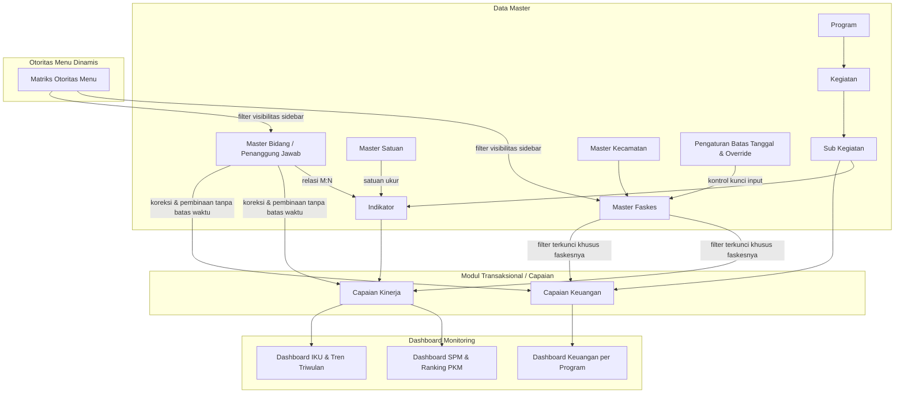

# Spesifikasi Kebutuhan Sistem & Desain Teknis

## GASS — Dinas Kesehatan

Dokumen ini merupakan spesifikasi kebutuhan perangkat lunak dan arsitektur teknis menyeluruh untuk pengembangan **GASS - GERAKAN AKSI SEHAT SETARA pada Dinas Kesehatan**.

---

## 1. Arsitektur & Alur Data Sistem

Sistem dirancang mengadopsi standar penganggaran dan akuntabilitas kinerja instansi pemerintah (Renja / SIPD / Renstra Dinas Kesehatan).

Terdapat pemisahan tingkat evaluasi antara kinerja teknis dan keuangan:

- **Capaian Kinerja**: Berada pada level **Indikator** (menampilkan Sub-Kegiatan induknya).
- **Capaian Keuangan**: Berada pada level **Sub-Kegiatan** (menampilkan Kegiatan induknya) sesuai struktur Dokumen Pelaksanaan Anggaran (DPA).
- **Dashboard Monitoring**: Menjadi pusat visualisasi eksekutif yang mengagregasikan data capaian kinerja dan keuangan secara interaktif.
- **Kontrol Periode Input & Fase Pra-Launching**: Pembatasan jadwal pengisian data bagi faskes secara praktis (default tanggal 5 bulan berikutnya) dengan fitur status **BUKA / TUTUP** otomatis, manual override, serta mode inisialisasi pra-launching untuk melengkapi data lampau (_backfill_).
- **Isolasi Data Faskes (Data Scoping)**: Operator Faskes secara mutlak terkunci hanya dapat mengakses dan melihat data faskes miliknya sendiri di seluruh menu.
- **Otoritas Akses Dinamis**: Pengaturan menu berbasis peran pengguna dengan tabel matriks centang (_checkbox permission_), di mana Admin Puskesmas tidak memiliki akses maupun visibilitas terhadap menu Data Master.



---

## 2. Spesifikasi Modul Master Data

### 2.1. Master Satuan

Menstandarkan satuan pengukuran agar dinamis dan konsisten di seluruh indikator.

| Field        | Label Form         | Tipe Input   | Aturan & Keterangan                                                                              |
| :----------- | :----------------- | :----------- | :----------------------------------------------------------------------------------------------- |
| `namaSatuan` | Nama Satuan        | Teks Singkat | Wajib diisi, unik (contoh: _Persen_, _Orang_, _Kasus_, _Dokumen_, _Balita_, _Ibu Hamil_, _Desa_) |
| `simbol`     | Simbol / Singkatan | Teks Singkat | Opsional (contoh: `%`, `org`, `Lap`, `Balita`)                                                   |
| `keterangan` | Keterangan         | Textarea     | Opsional, konteks penggunaan                                                                     |

---

### 2.2. Master Program

Menampung program kerja tahunan Dinas Kesehatan.

| Field           | Label Form       | Tipe Input        | Aturan & Keterangan                                                                                                                  |
| :-------------- | :--------------- | :---------------- | :----------------------------------------------------------------------------------------------------------------------------------- |
| `tahun`         | Tahun Anggaran   | Number / Select   | Wajib diisi (contoh: `2026`, `2027`)                                                                                                 |
| `kodeProgram`   | Kode Program     | Teks Singkat      | Wajib diisi (contoh: `1.02.01`, `1.02.02`)                                                                                           |
| `namaProgram`   | Nama Program     | Teks              | Wajib diisi (contoh: _Program Pemenuhan Upaya Kesehatan Perorangan dan Upaya Kesehatan Masyarakat_)                                  |
| `isAksesFaskes` | Hak Akses Faskes | Checkbox / Switch | Menentukan apakah faskes/puskesmas diizinkan menginput capaian keuangan untuk program ini (misal Program 1, 2, 5). Default: `false`. |

> _Kombinasi `[kodeProgram, tahun]` bersifat unik._

---

### 2.3. Master Kegiatan

Klasifikasi program kerja dalam struktur belanja/kinerja.

| Field          | Label Form    | Tipe Input      | Aturan & Keterangan                                                                |
| :------------- | :------------ | :-------------- | :--------------------------------------------------------------------------------- |
| `programId`    | Program       | Dropdown Relasi | Wajib diisi, memilih dari Master Program                                           |
| `kodeKegiatan` | Kode Kegiatan | Teks Singkat    | Wajib diisi (contoh: `1.02.01.2.01`)                                               |
| `namaKegiatan` | Nama Kegiatan | Teks            | Wajib diisi (contoh: _Penyediaan Fasilitas Pelayanan Kesehatan untuk UKM dan UKP_) |

---

### 2.4. Master Sub Kegiatan

Unit operasional di bawah Kegiatan yang menjadi induk tolok ukur indikator serta induk realisasi anggaran belanja.

| Field             | Label Form        | Tipe Input      | Aturan & Keterangan                                     |
| :---------------- | :---------------- | :-------------- | :------------------------------------------------------ |
| `kegiatanId`      | Kegiatan          | Dropdown Relasi | Wajib diisi, memilih dari Master Kegiatan               |
| `kodeSubKegiatan` | Kode Sub Kegiatan | Teks Singkat    | Wajib diisi (contoh: `1.02.01.2.01.0001`)               |
| `namaSubKegiatan` | Nama Sub Kegiatan | Teks            | Wajib diisi (contoh: _Operasional Pelayanan Puskesmas_) |

---

### 2.5. Master Indikator

Menampung tolok ukur kinerja teknis kesehatan, ambang batas penilaian (_threshold_), dan penanggung jawab bidang teknis.

| Field                | Label Form                | Tipe Input                         | Aturan & Keterangan                                                                                                                                                  |
| :------------------- | :------------------------ | :--------------------------------- | :------------------------------------------------------------------------------------------------------------------------------------------------------------------- |
| `subKegiatanId`      | Sub Kegiatan              | Dropdown Relasi                    | Wajib diisi, memilih dari Master Sub Kegiatan                                                                                                                        |
| `namaIndikator`      | Nama Indikator            | Textarea / Teks                    | Wajib diisi (contoh: _Persentase Ibu Bersalin Mendapatkan Pelayanan Persalinan Sesuai Standar_)                                                                      |
| `satuanId`           | Satuan Indikator          | Dropdown Relasi                    | Wajib diisi, memilih dari Master Satuan                                                                                                                              |
| `kategoriIndikator`  | Kategori Indikator        | Dropdown / Radio                   | Wajib diisi, pilihan opsi:<br>• `IKK` (Indikator Kinerja Kunci)<br>• `IKU` (Indikator Kinerja Utama)<br>• `SPM` (Standar Pelayanan Minimal)<br>• `INDIKATOR_PROGRAM` |
| `jenisThreshold`     | Basis Penentuan Threshold | Pilihan (Radio)                    | • `PERSENTASE_TARGET` _(Default, berbasis % capaian realisasi terhadap target)_<br>• `NILAI_ABSOLUT` _(Berbasis angka riil satuan indikator)_                        |
| `thresholdHijauMin`  | Batas Bawah Hijau         | Number (Float)                     | Ambang batas kategori Baik / Target Terpenuhi (contoh: $\ge 80\%$)                                                                                                   |
| `thresholdKuningMin` | Batas Bawah Kuning        | Number (Float)                     | Ambang batas kategori Cukup / Perhatian (contoh: $\ge 50\%$)                                                                                                         |
| `thresholdMerahMax`  | Batas Atas Merah          | Number (Float)                     | Ambang batas kategori Kurang / Bahaya (contoh: $< 50\%$)                                                                                                             |
| `bidangIds`          | Penanggung Jawab (Bidang) | **Multi-Select (Tags / Checkbox)** | Wajib diisi. Mendukung **multi-bidang** (bisa memilih lebih dari 2 bidang pembina)                                                                                   |

---

### 2.6. Master Kecamatan

Wilayah administratif di tingkat kabupaten/kota.

| Field           | Label Form     | Tipe Input   | Aturan & Keterangan                                   |
| :-------------- | :------------- | :----------- | :---------------------------------------------------- |
| `kodeKecamatan` | Kode Kecamatan | Teks Singkat | Wajib diisi, unik (contoh: `74.05.01`)                |
| `namaKecamatan` | Nama Kecamatan | Teks Singkat | Wajib diisi (contoh: _Andoolo_, _Palangga_, _Kolono_) |

---

### 2.7. Master Faskes (Fasilitas Pelayanan Kesehatan)

Unit kerja layanan operasional kesehatan pelapor kinerja dan serapan keuangan.

| Field         | Label Form     | Tipe Input        | Aturan & Keterangan                                                                               |
| :------------ | :------------- | :---------------- | :------------------------------------------------------------------------------------------------ |
| `namaFaskes`  | Nama Faskes    | Teks              | Wajib diisi (contoh: _Puskesmas Andoolo Utama_, _RSUD Konsel_)                                    |
| `jenisFaskes` | Jenis Faskes   | Dropdown (Select) | Wajib diisi, pilihan nilai:<br>• `PUSKESMAS`<br>• `KLINIK`<br>• `RUMAH_SAKIT`<br>• `LABORATORIUM` |
| `kecamatanId` | Kecamatan      | Dropdown Relasi   | Wajib diisi, memilih dari Master Kecamatan                                                        |
| `alamat`      | Alamat Lengkap | Textarea          | Opsional, alamat faskes                                                                           |

---

### 2.8. Master Penanggung Jawab / Bidang

Bidang internal di Dinas Kesehatan pembina urusan teknis indikator.

| Field          | Label Form         | Tipe Input   | Aturan & Keterangan                                                               |
| :------------- | :----------------- | :----------- | :-------------------------------------------------------------------------------- |
| `kodeBidang`   | Kode Bidang        | Teks Singkat | Opsional (contoh: `KESMAS`, `P2P`, `YANKES`, `SDK`)                               |
| `namaBidang`   | Nama Bidang        | Teks         | Wajib diisi (contoh: _Bidang Kesehatan Masyarakat_, _Bidang Pelayanan Kesehatan_) |
| `kepalaBidang` | Nama Kepala Bidang | Teks Singkat | Opsional, nama pejabat Kepala Bidang                                              |

---

### 2.9. Pengaturan Batas Waktu Input, Manual Override & Fase Pra-Launching

Alur penentuan batas akhir input laporan faskes dirancang sederhana, otomatis, dan fleksibel menyesuaikan fase implementasi sistem:

#### A. Aturan Standar Otomatis (Global Rule)

- Terdapat satu pengaturan global: **`batasTanggalInput`** (Default: **Tanggal 5**).
- **Logika Perhitungan:** Laporan bulan $N$ batas akhirnya jatuh pada tanggal $X$ di bulan $N+1$ pukul 23:59.  
  _Contoh:_ Laporan bulan **Agustus (Bulan 8)** memiliki batas akhir pengisian pada **5 September (Bulan 9) pukul 23:59**.
- Admin tidak perlu menginput tanggal satu per satu untuk setiap bulan. Sistem secara otomatis menerapkan formula ini sepanjang tahun.

#### B. Manual Override (Kondisi Khusus / Pengecualian)

Admin Dinkes dapat melakukan penyesuaian khusus per bulan jika terjadi kondisi tertentu:

- **Bulan & Tahun**: Memilih periode yang ingin diatur (misal: _Bulan 8 Tahun 2026_).
- **Status Override**:
  - `BUKA`: Membuka paksa form agar faskes tetap bisa input meski telah melewati tanggal batas standar.
  - `TUTUP`: Mengunci form lebih awal sebelum tanggal batas standar.
- **Batas Tanggal Khusus**: Menentukan tanggal deadline baru untuk periode tersebut (misal: _Perpanjangan s/d 12 September_).
- **Catatan / Keterangan**: Alasan perpanjangan atau penutupan.

#### C. Fase Pra-Launching & Pengisian Data Historis (Backfill Data)

- **Kondisi Khusus Menjelang Launching:**
  - Sebagai contoh, jika peluncuran (_launching_) aplikasi dijadwalkan pada **1 November**, maka pada akhir Oktober aplikasi sudah harus siap digunakan dan seluruh faskes wajib menginput data bulan-bulan sebelumnya (misal: Januari s/d Oktober) agar saat launching, data dashboard eksekutif untuk Kepala Dinas / Bupati sudah terisi lengkap.
  - Karena bulan-bulan lampau tersebut secara kalender sudah melewati tanggal 5, maka pada masa persiapan ini sistem menyediakan opsi **`isOtomatisAktif = false` (Mode Pra-Launching / Buka Penuh)** atau menggunakan **Manual Override BUKA**.
  - Dengan mode ini, semua bulan lampau tetap terbuka (_editable_) sehingga faskes dapat melengkapi data historis tanpa terblokir sistem.
- **Pemberlakuan Kunci Otomatis (Go-Live):**
  - Penguncian otomatis berbasis tanggal 5 baru mulai diaktifkan secara resmi (_isOtomatisAktif = true_) pada waktu yang ditentukan (misalnya mulai periode **Desember 2026** atau **Tahun Anggaran 2027**).

---

## 3. Spesifikasi Modul Capaian Kinerja

Modul ini digunakan untuk memantau pemenuhan target indikator pelayanan kesehatan faskes per bulan.

### 3.1. Filter Halaman & Isolasi Akun Faskes

1. **Tahun**: Dropdown tahun anggaran (Default: _Tahun Berjalan_ saat ini, misal `2026`).
2. **Filter Faskes (Otomatis Terkunci untuk Admin PKM)**:
   - Jika pengguna login sebagai **Admin Puskesmas / Faskes A**, maka filter faskes **otomatis terpilih "Faskes A" dan dalam status terkunci / disabled** (tidak dapat diganti ke faskes lain).
   - Pengguna dengan role **Admin Dinkes** dan **Akun Bidang** bebas memilih seluruh faskes se-kabupaten melalui dropdown filter.
3. **Bidang / Penanggung Jawab**: Dropdown filter bidang untuk menyaring indikator binaan bidang tertentu.

---

### 3.2. Struktur Tabel & Status Read-Only Bulanan (Buka / Tutup)

| Kolom / Field                  | Tipe & Format      | Aturan & Keterangan                                                                                                                                                                                                                                                                                                                                                                                          |
| :----------------------------- | :----------------- | :----------------------------------------------------------------------------------------------------------------------------------------------------------------------------------------------------------------------------------------------------------------------------------------------------------------------------------------------------------------------------------------------------------- |
| **Indikator & Sub Kegiatan**   | Teks Informatif    | Menampilkan **Nama Indikator** beserta label induk **Sub Kegiatan** dan satuannya.                                                                                                                                                                                                                                                                                                                           |
| **Target Kinerja**             | Number (Float)     | Target kinerja yang harus dicapai dalam 1 tahun anggaran.                                                                                                                                                                                                                                                                                                                                                    |
| **Bulan (Januari - Desember)** | Form Input Dinamis | **Perilaku Khusus Admin Puskesmas:**<br>• Bulan yang telah melewati batas deadline otomatis berstatus **"TUTUP" (Read-Only / Terkunci)** dengan ikon gembok.<br>• Bulan yang masih aktif berstatus **"BUKA" (Editable)**.<br>• Pada masa Pra-Launching, seluruh bulan lampau berstatus **"BUKA"** untuk pengisian data awal.<br>• _Akun Bidang dan Admin Dinkes selalu dapat mengedit semua bulan (Bypass)._ |
| **Realisasi**                  | Number (Float)     | Angka riil pencapaian pada bulan terkait (sesuai satuan indikator).                                                                                                                                                                                                                                                                                                                                          |
| **% (Persentase Capaian)**     | Auto-Calculated    | Dihitung otomatis oleh sistem:<br>$$\% = \left( \frac{\text{Realisasi}}{\text{Target Kinerja}} \right) \times 100\%$$                                                                                                                                                                                                                                                                                        |
| **Status / Threshold**         | Visual Badge       | Status warna otomatis berdasarkan persentase capaian terhadap batas threshold indikator:<br>• 🟢 **Hijau**: Nilai $\ge \text{thresholdHijauMin}$<br>• 🟡 **Kuning**: Nilai $\ge \text{thresholdKuningMin}$ s/d $< \text{thresholdHijauMin}$<br>• 🔴 **Merah**: Nilai $< \text{thresholdKuningMin}$                                                                                                           |

---

## 4. Spesifikasi Modul Capaian Keuangan

Modul ini digunakan untuk memantau pagu anggaran dan realisasi serapan anggaran belanja faskes pada tingkat Sub-Kegiatan (sesuai DPA).

### 4.1. Filter Halaman & Isolasi Akun Faskes

1. **Tahun**: Dropdown tahun anggaran (Default: _Tahun Berjalan_).
2. **Filter Faskes**: Otomatis terkunci pada faskes masing-masing jika login sebagai Admin PKM.
3. **Filter Program Faskes**: Untuk Admin PKM, sistem hanya menampilkan program-program yang diberi izin (`isAksesFaskes = true`, misal Program 1, 2, dan 5).

---

### 4.2. Struktur Tabel & Form Input Capaian Keuangan

| Kolom / Field                  | Tipe & Format      | Aturan & Keterangan                                                                                                                                                                                                                                                                                                 |
| :----------------------------- | :----------------- | :------------------------------------------------------------------------------------------------------------------------------------------------------------------------------------------------------------------------------------------------------------------------------------------------------------------ |
| **Sub Kegiatan & Kegiatan**    | Teks Informatif    | Menampilkan **Nama Sub Kegiatan** beserta label induk **Kegiatan** dan kodenya.                                                                                                                                                                                                                                     |
| **Target Pagu Anggaran**       | Mata Uang (Rp)     | Nilai pagu alokasi anggaran belanja dalam 1 tahun anggaran (format Rupiah).                                                                                                                                                                                                                                         |
| **Bulan (Januari - Desember)** | Form Input Dinamis | **Perilaku Khusus Admin Puskesmas:**<br>• Bulan yang lewat deadline otomatis berstatus **"TUTUP" (Read-Only)**.<br>• Bulan aktif berstatus **"BUKA" (Bisa diinput)**.<br>• Pada masa Pra-Launching, seluruh bulan lampau berstatus **"BUKA"** untuk pengisian data awal.<br>• _Akun Bidang selalu bisa mengoreksi._ |
| **Realisasi Belanja**          | Mata Uang (Rp)     | Nilai riil serapan belanja keuangan pada bulan terkait (format Rupiah).                                                                                                                                                                                                                                             |
| **% Serapan Keuangan**         | Auto-Calculated    | Dihitung otomatis oleh sistem:<br>$$\% = \left( \frac{\text{Realisasi Keuangan}}{\text{Target Pagu}} \right) \times 100\%$$                                                                                                                                                                                         |
| **Status / Threshold Serapan** | Visual Badge       | Indikator visual realisasi serapan anggaran:<br>• 🟢 **Hijau**: Serapan optimal ($\ge 80\%$ atau sesuai standar target periode)<br>• 🟡 **Kuning**: Serapan sedang / perhatian ($50\% - 79.9\%$)<br>• 🔴 **Merah**: Serapan rendah / lambat ($< 50\%$)                                                              |

---

## 5. Spesifikasi Modul Dashboard Monitoring & Visualisasi

Modul Dashboard merupakan pusat pemantauan eksekutif (_Executive Summary_) yang mengagregasikan seluruh hasil inputan Capaian Kinerja dan Capaian Keuangan secara interaktif dan visual.

### 5.1. Filter Global Dashboard (Header Control)

1. **Tahun**: Dropdown pilihan tahun anggaran (Default: _Tahun Berjalan_).
2. **Triwulan**: Pilihan filter periode triwulanan (_Semua Triwulan / Triwulan 1 / Triwulan 2 / Triwulan 3 / Triwulan 4_).
3. **Bulanan**: Pilihan filter bulan spesifik (_Januari s/d Desember_).
4. **Faskes Scoping**: Untuk login Admin PKM, dashboard otomatis menampilkan data faskesnya sendiri.

---

### 5.2. Dashboard Indikator SPM (Standar Pelayanan Minimal)

#### A. Card / Grid 12 Indikator SPM

- Menampilkan 12 kartu interaktif yang mewakili seluruh indikator dengan kategori `SPM`.
- Menampilkan target, realisasi kumulatif, persentase capaian (%), badge warna threshold, dan perbandingan jumlah faskes yang tercapai vs belum.

#### B. Detail Interaktif Saat SPM Tertentu Dipilih

1. **List Ranking Faskes / Puskesmas (Urutan Rendah ke Tinggi)**:
   - Menampilkan peringkat seluruh Puskesmas/Faskes dari nilai **terendah hingga tertinggi** (Merah/Kritis $\rightarrow$ Hijau/Tercapai).
   - Memudahkan pimpinan Dinas Kesehatan melihat Puskesmas mana yang paling tertinggal dan membutuhkan intervensi segera.
2. **Diagram Batang Capaian Faskes**:
   - Sumbu X: Nama-nama Puskesmas / Faskes.
   - Sumbu Y: Persentase Capaian (%).
   - Warna Batang: Mengikuti status threshold masing-masing faskes.

---

### 5.3. Diagram Tren Batang SPM (Tren Triwulanan)

- **Opsi 1: Diagram Tren Triwulan per Indikator SPM** (dropdown pilih SPM).
- **Opsi 2: Diagram Tren Batang Seluruh SPM per Triwulan** (_grouped comparison_).
- Mendukung tampilan berdampingan atau switch/toggle view.

---

### 5.4. Diagram Tren Batang IKU (Indikator Kinerja Utama)

- **Opsi 1: Diagram Tren Triwulan per Indikator IKU** (dropdown pilih IKU).
- **Opsi 2: Diagram Tren Batang Seluruh IKU per Triwulan** (_grouped comparison_).
- Mendukung tampilan berdampingan atau switch/toggle view.

---

### 5.5. Dashboard Keuangan (Serapan Anggaran)

1. **Target Keuangan per Program per Tahun**: Ringkasan Pagu Anggaran, Total Realisasi, dan % Serapan.
2. **Diagram Batang Komparasi Keuangan per Program**: Grafik ganda Batang Pagu vs Realisasi Belanja per program.

---

## 6. Spesifikasi Modul Peran, Hak Akses Pengguna & Manajemen Otoritas Menu Dinamis

Sistem membedakan hak akses dan otorisasi berdasarkan 4 kelompok pengguna (_User Roles_) dengan kontrol menu dinamis (_Dynamic Role-Menu Permissions_):

### 6.1. Matriks Otorisasi Pengguna Standar

| Kelompok Pengguna (Role)              | Hak Akses Menu Data Master                                                                                   | Hak Akses Capaian Kinerja                                                            | Hak Akses Capaian Keuangan                                                                                  | Batas Waktu Input (Jadwal)                                                                                                                | Dashboard & Laporan                                     |
| :------------------------------------ | :----------------------------------------------------------------------------------------------------------- | :----------------------------------------------------------------------------------- | :---------------------------------------------------------------------------------------------------------- | :---------------------------------------------------------------------------------------------------------------------------------------- | :------------------------------------------------------ |
| **ADMIN DINKES (Administrator)**      | **Full Akses** (Melihat & Mengelola Semua Master Data, Akun, Otoritas Menu & Jadwal)                         | View, Input, Edit, Hapus (Semua Faskes)                                              | View, Input, Edit, Hapus (Semua Faskes)                                                                     | **Tanpa Batas Waktu** (Bypass Jadwal)                                                                                                     | Full Akses Seluruh Fitur                                |
| **AKUN BIDANG**                       | **Parsial** (Input & Edit Master Program & Kegiatan yang menjadi kewenangan bidangnya)                       | View, Input, Edit, & **Koreksi/Verifikasi** (Khusus indikator binaan bidangnya)      | View, Input, Edit, & **Koreksi** (Khusus sub kegiatan binaan bidangnya)                                     | **Tanpa Batas Waktu** (Dapat membina dan mengoreksi data faskes kapan saja)                                                               | Dashboard & Rekap Kinerja Bidang                        |
| **ADMIN PUSKESMAS (Operator Faskes)** | **TIDAK ADA AKSES (HIDDEN TOTAL)**<br>_Menu Master Data tidak ditampilkan sama sekali pada navigasi sidebar_ | View & Input **Semua Program/Indikator** (Khusus faskesnya sendiri, filter terkunci) | View & Input **Hanya Program Tertentu yang Diizinkan** (misal Program 1, 2, 5 melalui flag `isAksesFaskes`) | **Dibatasi Batas Waktu Input** (Bulan lewat tanggal 5 otomatis status TUTUP / Read-Only, kecuali pada mode pra-launching / override buka) | Dashboard Khusus Faskesnya Sendiri                      |
| **AKUN KADIS (Kepala Dinas)**         | **Read-Only / Tersembunyi**                                                                                  | Read-Only (Monitoring)                                                               | Read-Only (Monitoring)                                                                                      | Tidak Menginput Data                                                                                                                      | Full Akses Dashboard Eksekutif, Grafik & Ranking Faskes |

---

### 6.2. Aturan Ketat untuk Admin Puskesmas (Fasilitas Pelayanan Kesehatan)

1. **Penyembunyian Total Menu Data Master**:
   - Menu Data Master (Satuan, Program, Kegiatan, Sub Kegiatan, Indikator, Faskes, Kecamatan, Penanggung Jawab) **dihilangkan sepenuhnya dari sidebar dan antarmuka Admin Puskesmas**.
   - Admin Puskesmas tidak memiliki akses untuk menambah, mengubah, maupun sekadar melihat halaman daftar master data.
2. **Isolasi Data (Data Scoping) & Penguncian Filter Faskes**:
   - Pada semua halaman (Capaian Kinerja, Capaian Keuangan, Dashboard), dropdown filter faskes **otomatis memilih faskes yang bersangkutan dan dinonaktifkan (disabled)**.
   - Contoh: Jika pengguna login sebagai Operator _Puskesmas Andoolo_, maka sistem hanya menampilkan data Puskesmas Andoolo. Pengguna tidak bisa memilih atau melihat data puskesmas lain.
   - Di tingkat backend (API), sistem memvalidasi `session.user.faskesId` sehingga data puskesmas lain tidak bisa diminta melalui manipulasi request API.
3. **Pengecekan Status Bulan: BUKA vs TUTUP (Read-Only Otomatis)**:
   - Saat Admin Puskesmas membuka halaman Capaian Kinerja / Keuangan, sistem mengevaluasi status tiap bulan:
     - **Jika Mode Pra-Launching Aktif (`isOtomatisAktif = false`)**: Seluruh bulan berstatus **"BUKA" (Aktif)** agar faskes dapat melakukan pengisian data awal (_backfilling_ data lampau).
     - **Jika Penguncian Otomatis Aktif (`isOtomatisAktif = true`)**:
       - **Status TUTUP (Read-Only)**: Untuk bulan-bulan yang telah melewati batas tanggal 5 bulan berikutnya (dan tidak ada override status BUKA). Field inputan menjadi tidak aktif (disabled) dan diberi label badge status **"TUTUP"** dengan ikon gembok.
       - **Status BUKA (Aktif)**: Untuk bulan berjalan yang belum melewati tanggal 5 bulan berikutnya, atau bulan yang diberi izin khusus via manual override oleh Admin Dinkes.
4. **Keleluasaan Akun Bidang (Korektor & Pembina)**:
   - Akun Bidang tetap dapat mengedit atau memperbaiki angka realisasi puskesmas kapan saja untuk keperluan verifikasi (Bypass batas waktu).

---

### 6.3. Menu Manajemen Otoritas (Dynamic Role-Menu Permissions Matrix)

Sistem menyediakan halaman khusus untuk Administrator Dinkes: **Menu Manajemen Otoritas**, yang menyajikan tabel matriks hak akses menu dengan sistem centang (_checkbox_).

#### Struktur Tampilan Matriks Otoritas:

```
+-----------------------------------------------------------------------------------+
| Menu / Fitur                    | Admin Dinkes | Akun Bidang | Admin PKM | Kadis  |
+-----------------------------------------------------------------------------------+
| [Dashboard]                     |     [v]      |     [v]     |    [v]    |  [v]   |
| [Master Satuan]                 |     [v]      |     [ ]     |    [ ]    |  [ ]   |
| [Master Program]                |     [v]      |     [v]     |    [ ]    |  [ ]   |
| [Master Kegiatan]               |     [v]      |     [v]     |    [ ]    |  [ ]   |
| [Master Sub Kegiatan]           |     [v]      |     [v]     |    [ ]    |  [ ]   |
| [Master Indikator]              |     [v]      |     [ ]     |    [ ]    |  [ ]   |
| [Master Kecamatan & Faskes]     |     [v]      |     [ ]     |    [ ]    |  [ ]   |
| [Master Bidang / PJ]            |     [v]      |     [ ]     |    [ ]    |  [ ]   |
| [Pengaturan Batas Waktu]        |     [v]      |     [ ]     |    [ ]    |  [ ]   |
| [Capaian Kinerja]               |     [v]      |     [v]     |    [v]    |  [ ]   |
| [Capaian Keuangan]              |     [v]      |     [v]     |    [v]    |  [ ]   |
| [Manajemen Pengguna & Otoritas] |     [v]      |     [ ]     |    [ ]    |  [ ]   |
+-----------------------------------------------------------------------------------+
```

- **Fitur Interaktif:**
  - Administrator cukup mencentang / menghilangkan centang pada tabel.
  - Perubahan langsung disimpan ke database.
  - Sidebar aplikasi secara dinamis hanya menampilkan menu-menu yang dicentang untuk role pengguna yang sedang login.

---

## 7. Skema Lengkap Basis Data (Prisma ORM)

Rancangan skema database terintegrasi yang mencakup Master Data, Pengaturan Batas Waktu & Pra-Launching, Capaian, Otorisasi Menu Dinamis, dan Audit Log:

```prisma
datasource db {
  provider = "sqlite" // atau postgresql / mysql
  url      = env("DATABASE_URL")
}

generator client {
  provider = "prisma-client-js"
}

// ==========================================
// 1. DATA MASTER
// ==========================================

model Satuan {
  id          String      @id @default(cuid())
  namaSatuan  String      @unique
  simbol      String?
  keterangan  String?
  indikator   Indikator[]
  createdAt   DateTime    @default(now())
  updatedAt   DateTime    @updatedAt
}

model Program {
  id            String           @id @default(cuid())
  kodeProgram   String
  namaProgram   String
  tahun         Int
  isAksesFaskes Boolean          @default(false) // True jika faskes boleh kelola keuangan program ini (misal Program 1, 2, 5)
  bidangId      String?                          // Relasi ke bidang pengelola jika diinput oleh akun bidang
  kegiatan      Kegiatan[]
  bidang        PenanggungJawab? @relation(fields: [bidangId], references: [id])
  createdAt     DateTime         @default(now())
  updatedAt     DateTime         @updatedAt

  @@unique([kodeProgram, tahun])
}

model Kegiatan {
  id             String        @id @default(cuid())
  programId      String
  kodeKegiatan   String
  namaKegiatan   String
  program        Program       @relation(fields: [programId], references: [id], onDelete: Cascade)
  subKegiatan    SubKegiatan[]
  createdAt      DateTime      @default(now())
  updatedAt      DateTime      @updatedAt
}

model SubKegiatan {
  id                String            @id @default(cuid())
  kegiatanId        String
  kodeSubKegiatan   String
  namaSubKegiatan   String
  kegiatan          Kegiatan          @relation(fields: [kegiatanId], references: [id], onDelete: Cascade)
  indikator         Indikator[]
  capaianKeuangan   CapaianKeuangan[]
  createdAt         DateTime          @default(now())
  updatedAt         DateTime          @updatedAt
}

model Indikator {
  id                 String             @id @default(cuid())
  subKegiatanId      String
  namaIndikator      String
  satuanId           String
  kategoriIndikator  String             @default("INDIKATOR_PROGRAM") // IKK, IKU, SPM, INDIKATOR_PROGRAM

  // Konfigurasi Threshold
  jenisThreshold     String             @default("PERSENTASE_TARGET") // PERSENTASE_TARGET, NILAI_ABSOLUT
  thresholdHijauMin  Float              @default(80.0)
  thresholdKuningMin Float              @default(50.0)
  thresholdMerahMax  Float              @default(49.9)

  subKegiatan        SubKegiatan        @relation(fields: [subKegiatanId], references: [id], onDelete: Cascade)
  satuan             Satuan             @relation(fields: [satuanId], references: [id])
  bidang             IndikatorBidang[]
  capaianKinerja     CapaianKinerja[]
  createdAt          DateTime           @default(now())
  updatedAt          DateTime           @updatedAt
}

model IndikatorBidang {
  id                String          @id @default(cuid())
  indikatorId       String
  bidangId          String
  indikator         Indikator       @relation(fields: [indikatorId], references: [id], onDelete: Cascade)
  bidang            PenanggungJawab @relation(fields: [bidangId], references: [id], onDelete: Cascade)

  @@unique([indikatorId, bidangId])
}

model PenanggungJawab {
  id              String            @id @default(cuid())
  kodeBidang      String?
  namaBidang      String
  kepalaBidang    String?
  indikator       IndikatorBidang[]
  programs        Program[]
  users           User[]
  createdAt       DateTime          @default(now())
  updatedAt       DateTime          @updatedAt
}

model Kecamatan {
  id            String   @id @default(cuid())
  kodeKecamatan String   @unique
  namaKecamatan String
  faskes        Faskes[]
  createdAt     DateTime @default(now())
  updatedAt     DateTime @updatedAt
}

model Faskes {
  id              String            @id @default(cuid())
  kecamatanId     String
  namaFaskes      String
  jenisFaskes     String            @default("PUSKESMAS") // PUSKESMAS, KLINIK, RUMAH_SAKIT, LABORATORIUM
  alamat          String?
  kecamatan       Kecamatan         @relation(fields: [kecamatanId], references: [id])
  users           User[]
  capaianKinerja  CapaianKinerja[]
  capaianKeuangan CapaianKeuangan[]
  createdAt       DateTime          @default(now())
  updatedAt       DateTime          @updatedAt
}

// ==========================================
// 2. PENGATURAN BATAS WAKTU & PRA-LAUNCHING
// ==========================================

model PengaturanSistem {
  id                   String   @id @default("default")
  batasTanggalInput    Int      @default(5)     // Default batas tanggal 5 di bulan berikutnya
  isOtomatisAktif      Boolean  @default(false) // False saat fase pra-launching (semua bulan terbuka untuk backfill), True saat aturan tanggal 5 mulai aktif
  mulaiOtomatisPeriode String?                  // Keterangan periode mulai berlakunya aturan tanggal 5 (misal: "Desember 2026" atau "Januari 2027")
  updatedAt            DateTime @updatedAt
}

model PeriodeOverride {
  id             String    @id @default(cuid())
  tahun          Int
  bulan          Int       // 1 - 12 (Januari s/d Desember)
  statusOverride String    // BUKA, TUTUP
  batasKhusus    DateTime? // Deadline khusus jika diperpanjang
  keterangan     String?   // Alasan perpanjangan/penutupan
  createdAt      DateTime  @default(now())
  updatedAt      DateTime  @updatedAt

  @@unique([tahun, bulan])
}

// ==========================================
// 3. MODUL TRANSAKSIONAL / CAPAIAN
// ==========================================

model CapaianKinerja {
  id            String     @id @default(cuid())
  indikatorId   String
  faskesId      String
  tahun         Int
  targetKinerja Float      @default(0)

  // Realisasi Tiap Bulan (Januari s/d Desember)
  capaianJan    Float      @default(0)
  capaianFeb    Float      @default(0)
  capaianMar    Float      @default(0)
  capaianApr    Float      @default(0)
  capaianMei    Float      @default(0)
  capaianJun    Float      @default(0)
  capaianJul    Float      @default(0)
  capaianAgs    Float      @default(0)
  capaianSep    Float      @default(0)
  capaianOkt    Float      @default(0)
  capaianNov    Float      @default(0)
  capaianDes    Float      @default(0)

  isValidated   Boolean    @default(false)
  indikator     Indikator  @relation(fields: [indikatorId], references: [id], onDelete: Cascade)
  faskes        Faskes     @relation(fields: [faskesId], references: [id], onDelete: Cascade)
  createdAt     DateTime   @default(now())
  updatedAt     DateTime   @updatedAt

  @@unique([indikatorId, faskesId, tahun])
}

model CapaianKeuangan {
  id             String      @id @default(cuid())
  subKegiatanId  String
  faskesId       String
  tahun          Int
  targetKeuangan Float       @default(0) // Pagu Anggaran (Rp)

  // Realisasi Belanja Tiap Bulan (Januari s/d Desember)
  capaianJan     Float       @default(0)
  capaianFeb     Float       @default(0)
  capaianMar     Float       @default(0)
  capaianApr     Float       @default(0)
  capaianMei     Float       @default(0)
  capaianJun     Float       @default(0)
  capaianJul     Float       @default(0)
  capaianAgs     Float       @default(0)
  capaianSep     Float       @default(0)
  capaianOkt     Float       @default(0)
  capaianNov     Float       @default(0)
  capaianDes     Float       @default(0)

  isValidated    Boolean     @default(false)
  subKegiatan    SubKegiatan @relation(fields: [subKegiatanId], references: [id], onDelete: Cascade)
  faskes         Faskes      @relation(fields: [faskesId], references: [id], onDelete: Cascade)
  createdAt      DateTime    @default(now())
  updatedAt      DateTime    @updatedAt

  @@unique([subKegiatanId, faskesId, tahun])
}

// ==========================================
// 4. PENGGUNA, OTORISASI & MATRIKS MENU
// ==========================================

model User {
  id        String           @id @default(cuid())
  email     String           @unique
  name      String
  password  String
  role      String           @default("OPERATOR_PUSKESMAS") // ADMIN_DINKES, AKUN_BIDANG, OPERATOR_PUSKESMAS, KEPALA_DINAS
  faskesId  String?
  bidangId  String?
  faskes    Faskes?          @relation(fields: [faskesId], references: [id])
  bidang    PenanggungJawab? @relation(fields: [bidangId], references: [id])
  createdAt DateTime         @default(now())
  updatedAt DateTime         @updatedAt
}

// Matriks Otoritas Menu Dinamis
model MenuPermission {
  id         String   @id @default(cuid())
  role       String   // ADMIN_DINKES, AKUN_BIDANG, OPERATOR_PUSKESMAS, KEPALA_DINAS
  menuKey    String   // dashboard, master_satuan, master_program, master_indikator, capaian_kinerja, dll
  canAccess  Boolean  @default(false)
  createdAt  DateTime @default(now())
  updatedAt  DateTime @updatedAt

  @@unique([role, menuKey])
}

model AuditLog {
  id        String   @id @default(cuid())
  userId    String
  action    String
  entity    String
  entityId  String
  details   String?
  createdAt DateTime @default(now())
}
```

frontend : nextjs, tanstack query, debounced, tailwind, wrapper refresh token,
BE : NestJs, postgree, prisma, redis, bullmq, email sender
